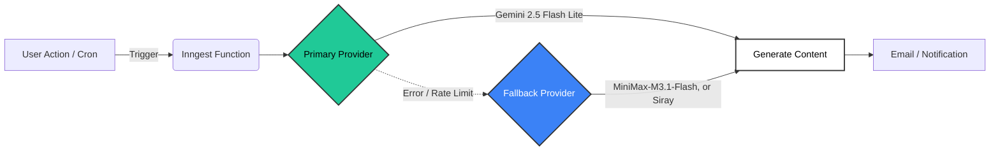

  
  <h1>OpenStock API & Architecture</h1>
  
  

    <b>Modern. Open. Resilient.</b>
  

  

    
    
    
  

---

## 🏗️ Architecture Overview

OpenStock leverages a resilient event-driven architecture powered by **Inngest**. We prioritize uptime for our generative features by utilizing a multi-provider AI strategy.

### 🧠 Intelligent Model Routing

We don't rely on a single point of failure. Our AI infrastructure automatically routes around outages.

---

## 🤝 AI Providers

Set `AI_PROVIDER` to `gemini` (the default), `minimax` or `siray`. The code is in `lib/ai-provider.ts`.

### Primary: Google Gemini
Writes the welcome emails and the weekly news summary with `gemini-2.5-flash-lite` (override with `GEMINI_MODEL`).

### Fallback: MiniMax or Siray
If the primary call fails, the same prompt is retried once on the fallback: MiniMax (`MiniMax-M3.1-Flash`, or `MINIMAX_MODEL`) when `MINIMAX_API_KEY` is set, otherwise Siray (`SIRAY_API_KEY`). If MiniMax or Siray is the primary, Gemini is the fallback. If every provider fails, the welcome email uses a standard intro and the digest a short placeholder line.

---

## ⚡ Serverless Functions (Inngest)

Our background jobs are defined in `lib/inngest/functions.ts`.

| ID | Type | Schedule/Trigger | Purpose |
| :--- | :--- | :--- | :--- |
| `sign-up-email` | 🔔 Event | `app/user.created` | **Personalized Onboarding.** Generates a custom welcome message based on user quiz results. |
| `weekly-news-summary` | ⏱️ Cron | `0 9 * * 1` (Mon 9AM) | **Market Intelligence.** Summarizes top financial news and broadcasts to all users via Kit. |
| `check-stock-alerts` | ⏱️ Cron | `*/5 * * * *` | **Real-time Monitoring.** Checks user price targets against live market data (realtime mode only; US stocks and crypto). |
| `check-inactive-users` | ⏱️ Cron | `0 10 * * *` | **Re-engagement.** Identifies dormant users (>30 days) and sends a "We miss you" nudge. |

---

## 🔌 API Integrations

<b>📈 Stock Data: Finnhub</b>

 

*   **Base URL:** `https://finnhub.io/api/v1`
*   **Key Features:** Quotes, search, company profiles, dividend data, market news.
*   **Auth:** `FINNHUB_API_KEY`, or several keys comma-separated in `FINNHUB_API_KEYS` (rotated; each adds 60 requests a minute). `NEXT_PUBLIC_FINNHUB_API_KEY` still works as a name. No key is sent to the browser.

<b>🌍 Saudi and Polish quotes: Yahoo Finance</b>

 

*   **Role:** Delayed quotes for Tadawul (`.SR`) and GPW Warsaw (`.WA`) on the dashboard, stock pages and watchlist, because TradingView embeds block Tadawul and show Warsaw only end of day.
*   **Auth:** None.

<b>📊 Charts and widgets: TradingView</b>

 

*   **Role:** Candle charts, heatmaps, financials, technicals and company profiles, as free embeds loaded in the browser.
*   **Auth:** None.

<b>🧭 Optional cards: Adanos and AlphAI</b>

 

*   **Adanos:** the sentiment card (Reddit, X, news, Polymarket). Auth: `ADANOS_API_KEY`.
*   **AlphAI:** the scored news card. Auth: `ALPHAI_API_KEY`.

<b>📧 Email & Marketing: Kit (ConvertKit)</b>

 

*   **Role:** High-volume user broadcasts and tag management.
*   **Key Endpoints:**
    *   `POST /v3/forms/{form_id}/subscribe` (adds a new user to the newsletter, `KIT_WELCOME_FORM_ID`)
    *   `POST /v3/broadcasts` (the weekly digest)
*   **Auth:** `KIT_API_KEY` • `KIT_API_SECRET`

<b>🗄️ Database: MongoDB Atlas</b>

 

*   **Connection:** Standard URI. Node, Docker and Vercel share one connection; on Cloudflare Workers each request opens its own.
*   **Collections:** `user`, `session` and `account` (Better Auth), `watchlists`, `watchlistlists` (named lists), `alerts`, `rate_limits`.

---

  Documentation © Open Dev Society. Built with ❤️ for the Open Source Community.

